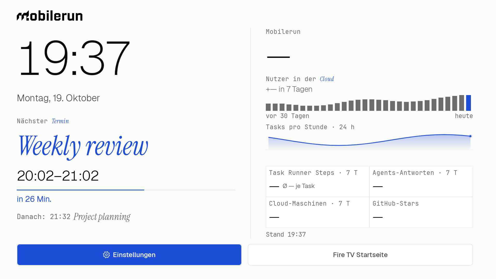

# Office TV Launcher

A Mobilerun-branded office TV home screen (light theme) for Fire TV (Fire OS 8 / Android 11).
It shows a German clock and date, a featured calendar, AirPlay readiness, aggregate Mobilerun statistics and GitHub stars.
The same view is available as a non-interactive Android screensaver.
Intended for a company-owned, sideloaded device; it is not meant for app-store distribution.

Parts adapted from an earlier internal Droidrun TV launcher. Bundled Geist, JetBrains Mono and Instrument Serif Italic fonts
are licensed under SIL OFL 1.1; see `licenses/`. The UI scales from the 1920×1080, 16:9 mockup.

Working with Claude Code? `.claude/skills/build-tv-launcher/SKILL.md` explains how to build a TV launcher like this from scratch; `.claude/skills/office-tv/SKILL.md` collects the device traps, the takeover design, the stats data path, design rules and a debugging checklist.



## Configuration

Configuration is embedded in the APK at build time. Rebuild and reinstall after changing it.
Values are read in this order: environment variables, Gradle properties (`-P` or
`~/.gradle/gradle.properties`), then the untracked repository-root `local.properties`.
An explicitly empty value takes precedence over lower-priority sources.
Never put `OFFICETV_STATS_URL` in the tracked project `gradle.properties`; use the
environment, `~/.gradle/gradle.properties` or untracked `local.properties` instead.

| Setting | Default | Meaning |
|---|---|---|
| `OFFICETV_STATS_URL` | empty | Full HTTPS URL of your aggregate stats endpoint. Surrounding whitespace is trimmed. Empty disables cloud polling and shows “Statistik nicht konfiguriert”. Non-HTTPS URLs and URLs containing userinfo (credentials) fail the build. |
| `OFFICETV_DEMO` | `false` | `true` shows “—” placeholders for all stat numbers on home and screensaver, synthetic chart shapes and sample calendar events, with all app networking disabled. Accepts only `true` or `false`. |
| `OFFICETV_GITHUB_REPO` | `droidrun/mobilerun` | Public GitHub repository (`owner/name`) for the stars tile. |

For example, set these in your shell or in `~/.config/firetv-launcher/env`, outside the repo:

```sh
export OFFICETV_STATS_URL=https://example.invalid/stats
export OFFICETV_GITHUB_REPO=owner/name
```

`scripts/tv.sh build` and `deploy` source that local file if it exists and export its
assignments to Gradle, alongside the inherited environment. The file is trusted shell
code. They warn if the stats URL environment variable is empty; a Gradle property can
still supply it. Direct `./gradlew` calls use the inherited environment and properties,
without sourcing that file.

For `~/.gradle/gradle.properties` or `local.properties`, use property syntax instead:

```properties
OFFICETV_STATS_URL=https://example.invalid/stats
OFFICETV_GITHUB_REPO=owner/name
```

The app sends `GET OFFICETV_STATS_URL` to one HTTPS stats endpoint with
`Authorization: Bearer <stats key>` and does not follow redirects. The response JSON is
`{"columns": [names], "results": [[one row of values]]}`: columns are mapped by name,
and series values are `[[time string, number], …]`. See the column names and synthetic
numbers, 30 days and 24 hours in `app/src/test/resources/stats-sample.json`.
Return aggregates only, never personal data or individual records. Use a
stats key with the narrowest permission available, scoped to running that endpoint
only; provision it separately using the owner setup below. Build settings are public
APK contents and must never contain credentials.

## Deploy to the office TV

### Prepare your machine and connect

You need JDK 17, Android SDK **platform 34**, Android SDK platform-tools (`adb` on your
`PATH`), and the office Wi-Fi. Set the SDK paths for your machine:

```sh
export JAVA_HOME="<path-to-jdk-17>"
export ANDROID_HOME="<path-to-android-sdk>"
export PATH="$ANDROID_HOME/platform-tools:$PATH"
```

Enable debugging using [Enable ADB on the TV](#enable-adb-on-the-tv) below. Confirm the
**Allow USB debugging** prompt on the TV for your computer's first connection.
On some Fire OS builds, network ADB switches off after a reboot; re-enable it if needed.

Prefer **TLS wireless debugging**: enable Wireless debugging, choose pairing by code,
and enter the displayed code when prompted. Pairing and connection ports differ.
Use the TV's advertised `_adb-tls-connect._tcp` port for the connection, not its pairing port:

```sh
adb pair TV_IP:PAIR_PORT
adb mdns services
adb connect TV_IP:TLS_CONNECT_PORT
export TV=TV_IP:TLS_CONNECT_PORT
```

Legacy `adb connect TV_IP:5555` also works, but is **unencrypted on the LAN**:

```sh
adb connect TV_IP:5555
export TV=TV_IP:5555
```

If this Fire OS build has no TLS wireless debugging, use legacy ADB for the contributor
loop and a trusted wired ADB connection for key provisioning (`export TV=<serial>`
from `adb devices`). Do not send the stats
key over legacy network ADB; rotate it if it was sent that way. For both `key` and
`calendar`, network serials (`host:port`) are refused unless `TV_TRANSPORT_TRUSTED=1`
is set. Use that override only after verifying TLS pairing or a trusted isolated link;
wired serials need no override. Successful provisioning prints `stored`; rejected input
prints `invalid` and exits non-zero.

### Enable ADB on the TV

**Fire TV:** Settings → My Fire TV → About → select the device name **7 times** to
unlock Developer options. Return to Developer options → **ADB debugging** and enable
network debugging too if shown.

**Android / Google TV:** Settings → System → About → select **Android TV OS build
7 times**. Open Developer options → USB/network debugging or **Wireless debugging**.
Menu labels vary with firmware. Accept the RSA authorization prompt using the remote.

| Symptom | Fix |
|---|---|
| `unauthorized` | Accept the RSA prompt on the TV and select “Always allow” for your trusted computer. If no prompt appears, run `adb kill-server`, reconnect and check the TV again. |
| Connection refused | Re-enable ADB/network debugging on the TV; some Fire OS builds switch it off after a reboot. Check the port displayed by the TV. |
| Timeout / no route | Wake the TV from standby/network sleep. Check both endpoints' subnet/VLAN and routing, guest Wi-Fi restrictions and AP/client isolation. |
| `offline` | Run `adb disconnect '<address:port>'`, reconnect, then try `adb kill-server` if needed. |
| Several devices attached | Select the intended target explicitly with `adb -s "$TV" …`; check `adb devices` first. |
| TLS wireless debugging | Run `adb pair '<address:pair-port>'` using the TV's code, then `adb mdns services`; connect to its `_adb-tls-connect._tcp` port, not its pairing port. |
| TV fully off | Turn it on physically, or use Wake-on-LAN only if the TV supports it and network standby is enabled. ADB cannot wake a powered-off network interface. |

`adb kill-server` resets connections for all devices on the computer. After reconnecting,
`adb -s "$TV" get-state` should report `device` before deploying or changing settings.

### Everyday contributor loop

From the repository, build, install and open the app:

```sh
scripts/tv.sh deploy
scripts/tv.sh screenshot
scripts/tv.sh status
```

`TV` must stay exported for every device command. With legacy ADB, the one-command form
is `TV=TV_IP:5555 scripts/tv.sh deploy`; later commands still need `TV` set.
`deploy` only builds and installs: it leaves key provisioning and takeover setup to the owner.
Check `tv-screenshot.png` in your current directory and keep it out of commits.
`status` shows the installed version, bound accessibility services, screensaver component
and TOTAL PSS (target below 100 MB).

For build-only work, no TV is needed: `scripts/tv.sh build`. The script resolves the repo
root with Git and runs `./gradlew assembleDebug`. Its default APK is
`app/build/outputs/apk/debug/app-debug.apk`; set `APK` to install another build with
`scripts/tv.sh install`. `local.properties`, Gradle caches, build outputs and APKs are ignored by Git.
The project uses Kotlin 2.0.21, AGP 8.5.2 and Compose BOM 2024.10.01. Only debug builds
are enabled, signed with Android's default debug key, with debugging disabled
(`isDebuggable = false`). No release signing or CI is configured.

### First-time setup (TV owner only)

**Test both escape tiles before enabling takeover:** **Einstellungen** must open Settings
and **Fire TV Startseite** must open Amazon home. Both stay visible in the fixed bottom
bar. These are the only two buttons; the launcher does not discover installed apps.
Einstellungen starts focused.

The TV owner holds the stats key with permission to run the configured aggregate
endpoint only. Get the key from the owner and store it outside the repo at
`~/.config/firetv-launcher/stats-key`, readable only by your user. It must
never be committed. Override the file location with `STATS_KEY_FILE` if needed.
With `TV` set to a trusted TLS/wired connection:

```sh
scripts/tv.sh key       # reads the key file via stdin, never host command arguments
scripts/tv.sh enable    # enables HOME takeover, retaining other accessibility services
scripts/tv.sh dream     # optional: select the office screensaver and start its preview
```

Before `enable` or `dream` first changes settings, the script saves the original
accessibility service list, accessibility enabled value, screensaver component and
screensaver enabled value in `~/.config/firetv-launcher/tv-changes.log`, once per ADB
address. Keep that file on the setup computer for recovery. If the connection address
or port changes, use the original address when reverting, or restore the saved values
manually; a new address has a separate snapshot.

The service watches window changes from `com.amazon.tv.launcher` and opens the office
screen when `com.amazon.tv.launcher.ui.HomeActivity_vNext` appears. It cannot retrieve
window content and does not request key filtering. When Amazon home is already in front,
another window transition is needed. Fire OS updates can disable the service; run
`enable` again if needed. The screensaver shows a full-screen stat carousel without interactive controls;
Fire OS controls its idle timing. Home and screensaver both use `FLAG_KEEP_SCREEN_ON`
while visible; the app does not change system sleep settings.

### Escape routes and revert

**Einstellungen** and **Fire TV Startseite** each pause takeover for 30 seconds while
opening Settings or Amazon home. **Long-press OK** anywhere on the home screen also
pauses takeover for 30 seconds. Test these after enabling takeover.

To restore the saved accessibility/screensaver settings, uninstall the app (including
its stored key) and return to Amazon home, use the setup computer and its original `TV` address:

```sh
scripts/tv.sh revert
```

`revert` refuses to guess if the state log lacks originals for that address. If you only
installed the app without owner setup, uninstall it with `adb -s "$TV" uninstall ai.droidrun.officetv`.

### Contributing

Create your branch from `main` and open a PR against `main`. Before requesting
review, run the checks and inspect the actual TV screen with `scripts/tv.sh screenshot`:

```sh
./gradlew testDebugUnitTest lintDebug assembleDebug
node --test integrations/google-calendar/Code.test.cjs
```

There is no CI, so "green" means both local runs pass.

## Debloat & privacy

Optional telemetry opt-outs and unused-package changes are covered by the
[TV debloat skill](.claude/skills/tv-debloat/SKILL.md). It inventories the TV first,
presents a plan for the owner's approval, protects HOME/remote/AirPlay and system
services, and records exact originals outside the repo for recovery. Firmware updates
may undo changes; verify again afterwards.

## Screenshots

Build with synthetic data, then install and capture using the existing contributor loop:

```sh
export OFFICETV_DEMO=true
scripts/tv.sh deploy
scripts/tv.sh screenshot
```

Demo mode replaces every stat number (including deltas and averages) with “—” on home
and screensaver. It keeps synthetic 30-day bars, a 24-hour line, and sample
“Weekly review” / “Project planning” events today. “Stand HH:mm” uses the current
time. It starts no stats, stars or calendar polling and skips AirPlay discovery, so no
app network traffic or real cached data reaches the screenshot. Takeover, keys and
provisioning work as usual. There are no added animations; keep the existing PSS budget
and verify on the TV. Rebuild with `OFFICETV_DEMO=false` to return to configured sources.
The README image slot is `docs/screenshot.png`; only add a verified demo capture there.

## Provision or clear the stats key

When upgrading from a build made before the stats storage rename, provision the key
once more with `scripts/tv.sh key`, even when installing with `install -r`. The renamed
keystore alias and preferences do not read the previously stored key; no migration is
performed. The host key file now defaults to `~/.config/firetv-launcher/stats-key`;
set `STATS_KEY_FILE` to use a different location.

The exported control receiver requires `android.permission.DUMP`, held by the ADB shell/system;
ordinary third-party apps cannot call it. Stats keys must be 16–512 characters from
`[A-Za-z0-9._~+/=_-]`, with no whitespace or control characters.
They are encrypted with AES/GCM using an AndroidKeyStore key (`officetv_stats`); only the
ciphertext and IV are saved in private preferences. Backup is disabled. Authentication failures,
permanently invalidated keys, missing ciphertext/IV or invalid decrypted values clear the stored value.
Other keystore errors retain the value and retry with normal backoff. Provisioning logs only `stats key stored` or `stats key cleared`, never the
key, headers, raw responses or exceptions. Rejected input is ignored.

`scripts/tv.sh key` provisions via stdin as described above. To clear the key
without uninstalling the app, run:

```sh
adb -s "$TV" shell am broadcast -a ai.droidrun.officetv.CLEAR_STATS_KEY -n ai.droidrun.officetv/.ControlReceiver
```

Do not run provisioning under shell tracing, paste the expanded key into chat, or capture its output
to a shared log. The key is passed to `am` on the TV, so a trusted ADB host/transport remains necessary.
The decrypted key is read immediately before each HTTPS request and is not retained across polling delays.

The endpoint configured by `OFFICETV_STATS_URL` is polled every 15 minutes with the stored
Bearer key. An empty URL disables cloud polling and shows `Statistik nicht konfiguriert`.
The parser maps columns by name. The GitHub stars source for `OFFICETV_GITHUB_REPO`
is unauthenticated and polled every 60 minutes.
Each source backs off separately on failure: 1, 2, 4, 8, 16, 32, then at most 60 minutes.
Connect/read timeouts are 15 seconds. Polling stops when both home and screensaver are inactive.

Last successful aggregate snapshots and fetch times are retained in memory and private JSON preferences,
including across restarts. Offline screens keep the last good values; never-loaded values are omitted.
`Stand HH:mm` refers to the cloud snapshot, or the GitHub snapshot if cloud stats have never loaded.
Missing or rejected credentials show only `Stats-Schlüssel fehlt` or `Stats-Schlüssel abgelehnt`.
Clearing a key preserves aggregate snapshots, but stops authenticated fetching until a key is provided.

**Every endpoint accessible to the stats key must stay aggregate-only.** If the key can
reach several endpoints, all of them must return aggregates only, never personal data
or individual records.

AirPlay is marked ready only after `_airplay._tcp` discovery resolves a service to one of the TV's
own IPv4 addresses. A small “AirPlay bereit” pill is the only AirPlay content on home.
Discovery stops in `onStop`. The installed AirPlay implementation displays the pairing PIN itself;
this app neither reads nor fabricates a PIN.

## Calendar

Today's next meeting flows from the default Google Calendar through a token-protected,
read-only Apps Script and a restricted HTTPS redirect into `CalendarRepository`, a private
last-good snapshot, and the home/screensaver displays. Provision its secret URL with
`scripts/tv.sh calendar` via stdin; never commit the URL, token, account or real event data.
See the [calendar integration guide](integrations/google-calendar/README.md) for setup,
provisioning, rotation, example URL/response and troubleshooting, or use the reusable
[Google Calendar setup skill](.claude/skills/google-calendar-setup/SKILL.md).

On home, the calendar is featured below the clock/date in the left column: a large blue
Instrument Serif italic title (up to two ellipsized lines), a large Geist time range,
blue countdown/status text and a thin progress bar. The bar fills during the last hour
before the start, then shows elapsed meeting time. It uses the existing minute clock
without animation or another timer. A muted “Danach” line shows the following event.
Empty/unreachable calendars show a calm, larger muted message; unconfigured calendars
leave the area clear. AirPlay instructions and installed-app tiles are removed.

With the **Mobilerun Office TV accessibility service enabled** (`scripts/tv.sh enable`),
the TV shows a large, silent reminder one minute before each of today's upcoming events.
The white card appears at the top over the launcher, other apps, AirPlay, or the screensaver:
"In 1 Min.", the event title, and its local `HH:mm–HH:mm` time range. It slides/fades in,
holds for 10 seconds, fades out, and removes itself. Animator scale 0 disables the animation.
It takes no focus, touches or remote keys and has no sound or dismissal.

The service keeps the existing shared five-minute calendar poll/backoff alive even when
the launcher is hidden. Polling and reminder scheduling pause while the screen is off;
turning it on during the minute before an event shows the reminder immediately. Events
already started are skipped. Each start instant + title is shown once per day in process
memory (a process restart clears that memory). No additional permission is needed.
Cards for events with the same start are shown one after another, each for its full
lifetime. Failed window additions retry after 15 seconds until the event starts.
Changing the TV clock or time zone replans pending reminders.

Test the overlay with synthetic data, without a configured calendar:

```sh
TV=<address:port> scripts/tv.sh reminder-test
```

This DUMP-protected command shows "Test Review" with a time range starting in one minute.
If a card is already visible, the command reports unavailable; retry after it disappears.
Check it over another app and the screensaver, verify the remote still controls the
underlying app, and measure PSS after the card disappears. Runtime behavior on Fire OS
must be verified on the TV.

## Takeover recovery behavior

The pause hint is `Umleitung 30 s pausiert`; a long press does not also activate the
focused tile. Settings falls back to Amazon home if no settings activity exists.
Bypass uses monotonic elapsed time, independent of wall-clock changes. Takeover resumes
after 30 seconds on the next Amazon-home window event; there is no timer that forcibly
leaves Settings. Bypass is process-local and expires if the process restarts. Back on the
office home screen is a no-op. A rolling limiter allows at most three takeover launches
per minute; a fourth attempt pauses takeover for five minutes to prevent rapid restart
loops. This limiter is also process-local.

## On-device acceptance

Verify behavior on the TV as well as with JVM tests and lint. Check both escape
tiles first, held OK, HOME takeover, reboot persistence, screensaver, featured calendar, real stats,
offline retained values, AirPlay mirroring with a visible PIN, and total PSS using
`adb shell dumpsys meminfo ai.droidrun.officetv` (target below 100 MB). Confirm the encrypted-key
receiver permission and no key exposure in the built APK or logs. An independent security review
is required for key provisioning/storage; build success does not replace it.

## Screensaver and burn-in protection

`scripts/tv.sh dream` selects/enables the office screensaver and immediately starts
a preview using `am start -n com.android.systemui/.Somnambulator`.

The screensaver advances every 20 seconds with a crossfade and a slight upward slide:
clock and date, cloud users (with new users in seven days), Task Runner Steps,
Agents-Antworten, Cloud-Maschinen, then GitHub-Stars. Stats that have never loaded
are skipped; cached values remain available offline. A blue hairline shows progress
through the current interval. The interactive home screen keeps its two escape buttons,
featured calendar and AirPlay readiness pill.

Home stat digits roll only after their initial value has been shown, including when
starting from the persisted cache. An increase in the displayed user total briefly
shows a blue +N. The hourly tasks chart reveals updated data from left to right,
with a gradient area and a small pulsing endpoint. Advancing the 24-hour window
alone does not replay the reveal. Chart paths and fill are cached; the halo and
screensaver progress hairline each redraw in a separate small layer. The dream does
not run AirPlay discovery, read network names, or collect installed apps.

Both home and screensaver move the complete layout through a fixed cycle within
±6 dp every three minutes, transitioning over two seconds. Between 22:00 and 07:00
in the TV's local time, a black scrim dims content to 55% brightness without a
full-screen alpha buffer. This reduces static exposure;
the app does not change panel brightness or Fire OS sleep settings. Both the home
activity and screensaver window use `FLAG_KEEP_SCREEN_ON` so automatic screen-off
does not interrupt them while they are shown. Setting the
system animator duration scale to zero disables animated transitions, the endpoint
pulse, and the transient +N flash; carousel changes and drift still occur instantly,
and the clock continues updating each minute.

TV acceptance must verify digit carries, first-load/cache behavior, the full carousel,
night boundaries, increased font scale, reduced motion, and steady-state total PSS
clearly below 100 MB on home as well as during the screensaver.

## License

Code is MIT-licensed (see `LICENSE`). Bundled fonts are under SIL OFL 1.1 (see `licenses/`).
The Mobilerun and Droidrun names and logos are trademarks of Droidrun and are not licensed under MIT.
Fire TV and Alexa are trademarks of Amazon; AirPlay is a trademark of Apple Inc. They are used here only to describe compatibility.
